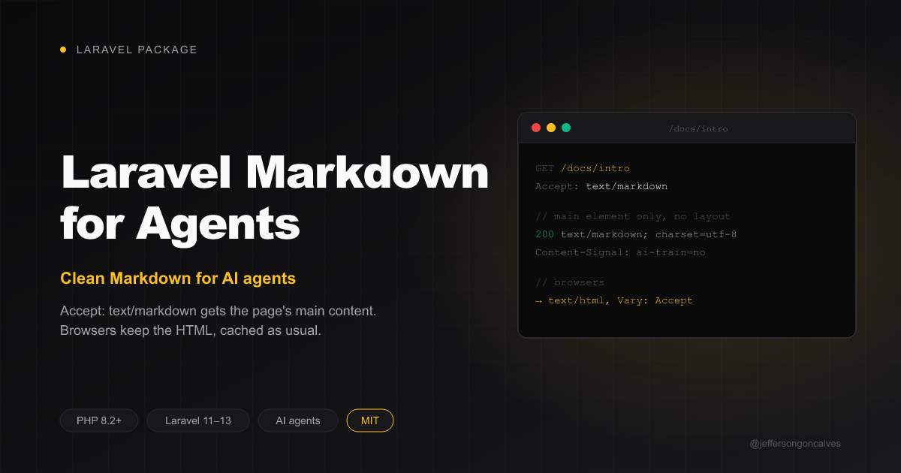

<div class="filament-hidden">



</div>

# Laravel Markdown for Agents

[](https://buymeacoffee.com/jeffersongoncalves)

[](https://packagist.org/packages/jeffersongoncalves/laravel-markdown-for-agents)
[](https://github.com/jeffersongoncalves/laravel-markdown-for-agents/actions?query=workflow%3ATests+branch%3Amain)
[](https://github.com/jeffersongoncalves/laravel-markdown-for-agents/actions?query=workflow%3A"Fix+PHP+code+styling"+branch%3Amain)
[](https://packagist.org/packages/jeffersongoncalves/laravel-markdown-for-agents)

Serve clean Markdown to AI agents. A request with `Accept: text/markdown` gets the page's main content converted to Markdown, instead of a dense HTML layout the agent has to scrape. Browsers keep getting HTML.

It is an origin-side equivalent of Cloudflare's [Markdown for Agents](https://developers.cloudflare.com/fundamentals/reference/markdown-for-agents/), which only runs on Pro zones and above.

- Only the page's `<main>` element is converted (configurable), so the navigation, header and footer stay out. Falls back to `<body>`.
- `<script>`, `<style>`, `<svg>`, forms, `<nav>`, `<footer>`... are dropped (configurable).
- YAML front matter with the page `<title>` and URL.
- Optional `Content-Signal` header ([contentsignals.org](https://contentsignals.org/)) to declare your AI preferences, e.g. `ai-train=no`.
- Every HTML response gets `Vary: Accept`, so HTTP caches keep the two representations apart.
- Only `GET` `200` `text/html` responses are converted. JSON, redirects, errors and excluded paths pass through untouched.

```http
GET /docs/intro HTTP/1.1
Accept: text/markdown

HTTP/1.1 200 OK
Content-Type: text/markdown; charset=utf-8
Vary: Accept
Content-Signal: search=yes, ai-input=yes, ai-train=no

---
title: "Introduction — My Docs"
url: https://example.com/docs/intro
---

# Introduction

Install the package with [Composer](https://getcomposer.org)...
```

## Installation

```bash
composer require jeffersongoncalves/laravel-markdown-for-agents
```

Register the middleware as the **outermost** middleware of the `web` group, in `bootstrap/app.php`:

```php
use JeffersonGoncalves\MarkdownForAgents\Http\Middleware\NegotiateMarkdown;

->withMiddleware(function (Middleware $middleware) {
    $middleware->prependToGroup('web', NegotiateMarkdown::class);
})
```

Or on specific routes only:

```php
Route::middleware(NegotiateMarkdown::class)->group(function () {
    Route::get('/docs/{page}', DocsController::class);
});
```

### Full-page caches: register it outside them

The middleware converts the HTML the rest of the stack produced. Keep it **outside** any full-page cache middleware (e.g. register it with `prependToGroup` after the cache middleware, so it ends up first). Then the cache only ever stores HTML and converting is a cheap step on the way out.

If a full-page cache runs *outside* this middleware, it may store a Markdown body and serve it to a browser. Add `Accept` to that cache's key, or move this middleware outward.

## Configuration

Publish the config file (optional):

```bash
php artisan vendor:publish --tag="markdown-for-agents-config"
```

```php
return [
    // Off: every response passes through untouched.
    'enabled' => (bool) env('MARKDOWN_FOR_AGENTS_ENABLED', true),

    // Tag name of the element converted (the first one). Falls back to <body>.
    'element' => 'main',

    // Elements dropped (with their content) before conversion.
    'remove_nodes' => ['script', 'style', 'noscript', 'svg', 'template', 'form', 'button', 'iframe', 'nav', 'footer'],

    // YAML front matter with the page <title> and URL.
    'front_matter' => true,

    // `Content-Signal` header on Markdown responses, e.g. "search=yes, ai-input=yes, ai-train=no".
    // Keep it in sync with your robots.txt. null sends no header.
    'content_signal' => env('MARKDOWN_FOR_AGENTS_CONTENT_SIGNAL'),

    // Request::is() patterns never converted, e.g. ['admin', 'admin/*'].
    'except' => [],
];
```

### Content signals in robots.txt

Declare the same preferences for crawlers in `public/robots.txt`:

```
User-agent: *
Content-Signal: search=yes, ai-input=yes, ai-train=no
Allow: /
```

## Converting HTML yourself

```php
use JeffersonGoncalves\MarkdownForAgents\MarkdownConverter;

$markdown = MarkdownConverter::convert($html, url: 'https://example.com/page');
```

## How it decides

The client gets Markdown only when it prefers `text/markdown` over `text/html` (`Request::prefers()`):

| `Accept` | Response |
| --- | --- |
| `text/markdown` | Markdown |
| `text/html;q=0.5, text/markdown` | Markdown |
| `text/html,application/xhtml+xml,*/*;q=0.8` (browsers) | HTML |
| `*/*` or no `Accept` | HTML |

## Testing

```bash
composer test
```

## Changelog

Please see [CHANGELOG](CHANGELOG.md) for more information on what has changed recently.

## Contributing

Please see [CONTRIBUTING](.github/CONTRIBUTING.md) for details.

## Security Vulnerabilities

Please review [our security policy](../../security/policy) on how to report security vulnerabilities.

## Credits

- [Jefferson Gonçalves](https://github.com/jeffersongoncalves)
- [All Contributors](../../contributors)

## License

The MIT License (MIT). Please see [License File](LICENSE.md) for more information.
